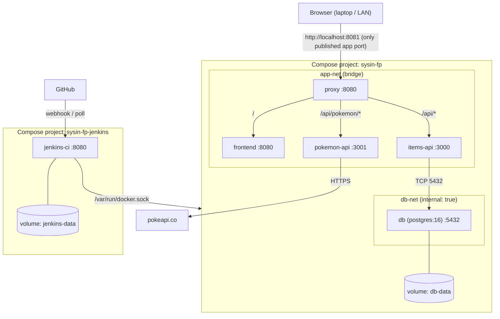

[README.md](https://github.com/user-attachments/files/33305306/README.md)
# SYSIN-FP — Containerized Multi-Module Application with Automated CI/CD

**Course / Section:** _<fill in>_  **Group:** _<fill in>_

A small multi-container web application that is built, tested and deployed automatically: a `git push` triggers a **Jenkins** pipeline (running in Docker) that runs the tests, builds build-numbered **Docker** images, deploys them with **Docker Compose**, and smoke-tests the result. Failing tests stop the pipeline before deployment, data survives redeployments in a named volume, and any earlier build can be redeployed by image tag.

## Team

| Role | Member |
|---|---|
| Project Lead / Scrum Master | Fausto, Marcus |
| DevOps / CI-CD Engineer | Lucky, Luciano |
| Infrastructure Engineer | Ruby, Lorenz David |
| Backend and Database Engineer | Ballares, Felix |
| Frontend, QA, and Documentation Lead | Dy Guazo, Jonathan |

## Application modules

| Module | Folder | Tech | Responsibility |
|---|---|---|---|
| **proxy** | `proxy/` | Nginx (unprivileged) 1.27 | Single public entry point; routes `/` and `/api/...` |
| **frontend** | `frontend/` | Static HTML/CSS/JS on Nginx (unprivileged) | Dashboard UI (database explorer, Pokémon lookup); shows the live **build number** in the footer |
| **items-api** | `items-api/` | Node.js 22 + Express + `pg` | `GET /items`, `POST /items` (reads **and writes** PostgreSQL), `GET /health` |
| **pokemon-api** | `pokemon-api/` | Node.js 22 + Express | `GET /pokemon/:name` (calls the public PokeAPI), `GET /health` |
| **db** | `db/` | PostgreSQL 16 (Alpine) | Persistent data in the named volume `db-data`; schema from `db/init.sql` |
| **jenkins** | `infra/jenkins/` | Jenkins LTS + Docker CLI | CI/CD server, deployed as a **separate** Compose project |

## Architecture



**Key design points**

- **Only the proxy publishes a port** (`8081` → container `8080`). The database has no published port and sits on `db-net`, which is `internal` (no outbound internet); only `items-api` is attached to both networks.
- **Request routing**

  | Public URL | Goes to |
  |---|---|
  | `/` | `frontend` |
  | `/api/items` | `items-api` → `/items` |
  | `/api/pokemon/<name>` | `pokemon-api` → `/pokemon/<name>` |
  | `/api/items/health`, `/api/pokemon/health` | module health endpoints |
  | `/healthz` | answered by the proxy itself |

- **Images** are tagged `sysin-fp/<service>:<BUILD_NUMBER>` (default `dev` locally, never `latest`). The `db` image (`sysin-fp/db:pg16`) is deliberately not re-tagged per build, so a normal deploy never restarts the database.
- **Configuration is baked into images** (`nginx.conf`, `init.sql`) rather than bind-mounted, because bind-mount paths are resolved on the Docker *host*, not inside the Jenkins container.
- **Secrets** live in `.env` (never committed). Only `.env.example` is in Git; Jenkins injects the real `.env` from a *Secret file* credential.

## Repository layout

```text
.
├── Jenkinsfile               # declarative pipeline (pipeline as code)
├── docker-compose.yml        # application stack (project "sysin-fp")
├── .env.example              # placeholder configuration (copy to .env)
├── docs/                     # architecture diagram, technical documentation
├── proxy/                    # Nginx reverse proxy (Dockerfile, nginx.conf)
├── frontend/                 # static UI (Dockerfile stamps the build number)
├── items-api/                # Express + PostgreSQL API, unit tests
├── pokemon-api/              # Express API for the PokeAPI lookup, unit tests
├── db/                       # Dockerfile + init.sql (schema + seed data)
└── infra/jenkins/            # Jenkins image + separate compose file + plugins.txt
```

## Prerequisites

- Git, Docker Engine or Docker Desktop (WSL 2 on Windows), Docker Compose v2 (`docker compose`)
- ≥ 8 GB RAM recommended (Jenkins + the full stack)
- Free host ports **8080** (Jenkins) and **8081** (application)
- Verify (PowerShell):

  ```powershell
  git --version
  docker version
  docker compose version
  ```
- For the push-triggered demo: a public URL for Jenkins (e.g. `ngrok http 8080`) **or** use the Poll SCM fallback

## Run the application locally

All commands in this README are written for **Windows PowerShell**. Two PowerShell specifics: use `curl.exe` (plain `curl` is an alias for `Invoke-WebRequest` and rejects flags like `-fsS`), and set environment variables with `$env:NAME=value` instead of `NAME=value command`. On Linux/macOS, use `curl` and `NAME=value command`.

```powershell
git clone https://github.com/marcus2046/SYSIN-FP.git
cd SYSIN-FP
Copy-Item .env.example .env       # edit DB_PASSWORD in .env; never commit .env
docker compose up -d --build --wait
docker compose ps                 # every service should be "running (healthy)"
```

Open **http://localhost:8081**.

Quick checks:

```powershell
curl.exe -fsS http://localhost:8081/api/items
curl.exe -fsS http://localhost:8081/api/items/health
curl.exe -fsS http://localhost:8081/api/pokemon/health
curl.exe -fsS http://localhost:8081/api/pokemon/pikachu      # needs internet
```

Native PowerShell alternative: `Invoke-RestMethod http://localhost:8081/api/items`

Stop (keeps data): `docker compose down`.

> ⚠️ **Never run `docker compose down -v` on the demo project** — `-v` deletes the `db-data` volume. For experiments use a separate project:
>
> ```powershell
> $env:HTTP_PORT=8082; docker compose -p sysin-dev up -d --build
> Remove-Item Env:HTTP_PORT
> ```
>
> The database password is only read the **first time** the volume is created. Use the same `DB_PASSWORD` everywhere (local `.env` and the Jenkins credential) for the same volume.

## Run the tests

Tests run inside Docker through each backend's `test` build stage, exactly as Jenkins does:

```powershell
docker build --no-cache-filter test --target test -t sysin-fp/items-api:test ./items-api
$LASTEXITCODE        # 0 = tests passed
docker build --no-cache-filter test --target test -t sysin-fp/pokemon-api:test ./pokemon-api
$LASTEXITCODE
```

A non-zero exit code means a failing test. No Node.js is needed on the host.

## Start Jenkins (CI/CD server)

```powershell
cd infra/jenkins
docker compose up -d --build
docker exec jenkins-ci cat /var/jenkins_home/secrets/initialAdminPassword   # unlock password
```

1. Open **http://localhost:8080**, enter the unlock password, install the suggested plugins plus **Docker Pipeline**, and create an admin user with a **strong, unshared password**. Do not write Jenkins passwords into files in this repository.
2. Verify Jenkins can use Docker: `docker exec jenkins-ci docker ps` (it should list the host's containers). If it reports *permission denied* on `/var/run/docker.sock`, the Jenkins container user cannot access the socket — see the security note below.
3. **Manage Jenkins → Credentials → Add → Secret file**, ID `sysin-fp-env`, upload your real `.env` (same `DB_PASSWORD` the database volume was created with).
4. **New Item → Pipeline → Pipeline script from SCM** — repository `https://github.com/marcus2046/SYSIN-FP.git`, branch `main`, Script Path `Jenkinsfile`.

Jenkins data lives in the `jenkins-data` volume and survives restarts. Do not delete it with `down -v`.

### Automatic trigger

The `Jenkinsfile` declares both triggers:

- **Webhook (preferred):** expose Jenkins (`ngrok http 8080`), then GitHub → *Settings → Webhooks → Add webhook* → Payload URL `https://<public-host>/github-webhook/`, content type `application/json`, event *push*. Free tunnel URLs change on restart — update the webhook each time.
- **Poll SCM (fallback):** `pollSCM('H/2 * * * *')` checks for new commits roughly every 2 minutes; no public URL needed.

Clicking *Build Now* does not count as automatic deployment.

## Pipeline

| Stage | What it does | On failure |
|---|---|---|
| **Checkout** | `checkout scm` | Pipeline stops |
| **Test** | Builds each backend's `test` stage (`docker build --target test`) | **Stops before any build/deploy — running app unchanged** |
| **Build Images** | `docker compose build` with `TAG=<build number>`; `.env` injected from the `sysin-fp-env` credential | Stops; running app unchanged |
| **Deploy** | `docker compose up -d --no-build --remove-orphans --wait` | Stops; check `docker compose ps` / rollback |
| **Smoke Test** | From inside the proxy container: both `/health` endpoints respond and the page shows the new build number | Marks build failed |
| **post** | Always removes the temporary `.env`; reports success/failure | — |

## Persistence proof

```powershell
# 1. Create a record through the API (exercises the DB write path)
Invoke-RestMethod -Method Post -Uri http://localhost:8081/api/items `
  -ContentType 'application/json' -Body '{"name":"persist-proof"}'
curl.exe -s http://localhost:8081/api/items | Select-String persist-proof

# 2. Restart, then take the stack down and up again (no -v)
docker compose restart db
docker compose down
docker compose up -d --wait

# 3. The record is still there
curl.exe -s http://localhost:8081/api/items | Select-String persist-proof
docker volume ls | Select-String sysin-fp_db-data
```

## Rollback to an earlier build (no rebuild)

Every deploy keeps `sysin-fp/<service>:<build number>` images on the host.

```powershell
docker image ls --filter 'reference=sysin-fp/*'                # which tags exist
$env:TAG=14                                                    # build to roll back to
docker compose up -d --no-build --wait                         # redeploy build 14
Remove-Item Env:TAG                                            # don't leave TAG set in this session
curl.exe -s http://localhost:8081/ | Select-String 'id="build">[0-9a-z]*'   # shows 14
```

If `.env` is not in the directory, add `--env-file C:\path\outside\repo\.env`. Notes: rollback restores code, not data/schema; don't run `docker image prune -a` or `docker system prune -a` (they delete the old tags); `--no-build` with a tag that doesn't exist fails with `pull access denied`.

## Security notes

- Mounting `/var/run/docker.sock` into Jenkins gives it (and anyone who can edit the `Jenkinsfile` or log in) root-equivalent control of the host's Docker. This is acceptable for a lab, not for production. Safer alternatives: dedicated build agents, rootless Docker, Docker-in-Docker with TLS, Kaniko.
- Never expose Jenkins publicly (e.g. via a tunnel) with a weak or shared admin password.
- No credentials belong in Git. `.env` is git-ignored; Jenkins credentials hold the real values.

## Troubleshooting

| Symptom | Likely cause / fix |
|---|---|
| `required variable DB_PASSWORD is missing` | No `.env` in the project directory — `cp .env.example .env` |
| API: `password authentication failed` | `.env` password differs from the one the volume was created with |
| `502 Bad Gateway` | A backend isn't healthy yet — `docker compose ps`; `docker compose restart proxy` |
| `address already in use` | Port 8080/8081 taken — stop the other stack or change `HTTP_PORT` |
| Jenkins: `permission denied` on docker.sock | Jenkins user can't access the socket — run the container as root (lab) or add the host's docker GID via `group_add` |
| Pokémon lookup fails | No internet / PokeAPI down |
| Frontend shows build `dev` | Stack was started locally, not by the pipeline (`TAG` unset) |

## Documentation

- Architecture diagram: `docs/architecture.png` (source `docs/architecture.mmd`)
- Technical documentation: `docs/technical-documentation.pdf` _(to be added)_
